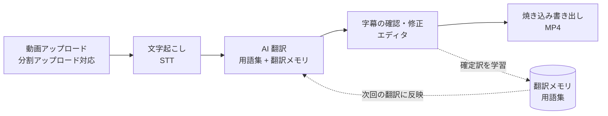

<div align="center">


# subtitlesmith

**動画をアップロードするだけで、文字起こし → AI 翻訳 → 字幕編集 → 焼き込み書き出しまで。**<br>
共有レンタルサーバーでも動く、セルフホスト型の動画字幕制作 Web アプリです。


[デモページ](https://haru-sudo.github.io/subtitlesmith/)

</div>

---

## 目次

- [概要](#概要)
- [主な機能](#主な機能)
- [処理の流れ](#処理の流れ)
- [対応エンジン・言語](#対応エンジン言語)
- [動作環境](#動作環境)
- [セットアップ](#セットアップ)
- [ログインの設定](#ログインの設定)
- [API キーなしで動かす（ローカル実行）](#api-キーなしで動かすローカル実行)
- [動画の分野に合わせる](#動画の分野に合わせる)
- [デプロイ](#デプロイ)
- [セキュリティ上の注意](#セキュリティ上の注意)
- [制限事項](#制限事項)
- [ディレクトリ構成](#ディレクトリ構成)
- [運用メモ](#運用メモ)
- [コントリビュート](#コントリビュート)
- [ライセンス](#ライセンス)

---

## 概要

subtitlesmith は、動画に **多言語字幕** を付けるための Web アプリです。
アップロードした動画をバックグラウンドで自動処理し、ブラウザ上でプレビューしながら字幕を確認・修正して、
字幕入りの MP4 として書き出せます。

- **ログインは許可制** — パスワード、または Google / Microsoft / Keycloak などの OpenID Connect でログインし、許可した人だけが使えます
- **使うほど賢くなる翻訳** — 用語集と翻訳メモリ（確定訳）を学習して精度が上がります
- **分野に合わせて調整可能** — 扱う動画の分野や翻訳ガイドを設定すると、AI がその分野の専門用語で訳します
- **クラウド API でもローカルでも** — Claude・Gemini・OpenAI 互換 API のほか、Ollama やサーバー上の Whisper / LLM でも動きます
- **共有レンタルサーバーで動作** — PHP + SQLite 構成。cron 不要でバックグラウンド処理を自動起動します

## 主な機能

| 機能 | 内容 |
| --- | --- |
| 自動文字起こし | Deepgram / OpenAI Whisper / サーバー上の faster-whisper から選択。時刻付きセグメントを生成 |
| AI 翻訳 | Claude（既定）・Gemini・OpenAI 互換 API（Groq・DeepSeek・Ollama・LM Studio など）・ローカル LLM に対応。文脈と用語集を踏まえて字幕向けに訳出 |
| 多言語字幕 | 1 本の動画に複数の出力言語を保持。後から言語を追加・削除でき、タブで切り替え |
| 字幕エディタ | プレビューを見ながら訳文・タイミングを修正。分割・削除・確認済みチェック、Ctrl/⌘+Z で削除を取り消し、Ctrl/⌘+S で保存 |
| 1 行の長さ警告 | 焼き込み時に自動改行される長さを超えた行に警告（全角 = 1、半角 = 0.5 文字で換算） |
| 焼き込み書き出し | FFmpeg で字幕入り MP4 を生成。言語ごとに別ファイルを出力し、言語に合わせたフォントを自動選択 |
| 動画のカット編集 | 指定区間の映像・音声・字幕をまとめて削除し、後続の字幕時刻を自動で繰り上げ |
| 用語集・翻訳メモリ | 専門用語を登録・AI で候補抽出。確定訳は埋め込みベクトル付きで蓄積し、類似訳を few-shot として活用 |
| Excel 入出力 | 字幕を `.xlsx` で書き出し、外部で編集したファイル（Excel / CSV）を取り込み |
| 焼き込み字幕の取り込み | 既存の字幕入り動画から字幕を読み取り、学習データとして取り込み |
| フォルダ管理 | 動画をフォルダで分類・移動 |
| お知らせ / 環境チェック | 更新情報ページ（`/news`）と、PHP・FFmpeg・API キー・ログイン設定を確認できる環境チェック（`/health`） |

## 処理の流れ



アップロード後の処理は `runner.php` がバックグラウンドで実行します（`Worker::spawn()` が自動起動するため cron は不要）。

## 対応エンジン・言語

**文字起こし（STT）**

| エンジン | 種別 | 目安コスト | 備考 |
| --- | --- | --- | --- |
| `deepgram-nova-3` | API | $0.0043 / 分 | 既定。時刻付きで字幕向き。無音時の幻聴が出にくい |
| `whisper-1` | API | $0.006 / 分 | セグメント時刻付き |
| `gpt-4o-transcribe` / `gpt-4o-mini-transcribe` | API | — | 字幕用途では時刻取得のため `whisper-1` で実行 |
| `local-whisper` | ローカル | 0 | faster-whisper をサーバー上で実行（[導入方法](#1-ローカル文字起こしfaster-whisper)） |

**翻訳**

| プロバイダ | 備考 |
| --- | --- |
| Claude（Anthropic） | 既定・最高精度。プロンプトキャッシュ対応 |
| Google Gemini | 無料枠あり |
| OpenAI 互換 | Groq / OpenRouter / DeepSeek / xAI / NVIDIA / Ollama / LM Studio のプリセットあり。任意の URL も指定可 |
| ローカル LLM | CTranslate2 でサーバー上の小型 LLM を実行。API コスト 0、常駐サーバー・GPU 不要（[導入方法](#2-ローカル翻訳)） |

**字幕の出力言語**

日本語 / 中国語（簡体字・繁体字）/ 韓国語 / 英語 / ドイツ語 / フランス語 / スペイン語 / ポルトガル語 / タイ語 / ベトナム語 / インドネシア語

音声（原語）は文字起こしエンジンが対応する言語なら何でも使えます（自動判定）。

## 動作環境

| 項目 | 要件 |
| --- | --- |
| PHP | 8.1 以上（拡張: `pdo_sqlite`, `curl`, `mbstring`, `json`, `fileinfo`、Excel 入出力に `zip`） |
| Web サーバー | Apache（`mod_rewrite` 有効）または nginx + PHP-FPM |
| FFmpeg | `ffmpeg` / `ffprobe`（書き出し・サムネイル・カット編集に使用） |
| フォント | 焼き込み用に出力言語のフォント（例: [Noto Sans CJK](https://github.com/notofonts/noto-cjk)） |
| Python 3 | 任意。ローカル文字起こし・ローカル翻訳・焼き込み字幕の取り込みを使う場合のみ |
| API キー | 使用するエンジンに応じて Anthropic / OpenAI / Deepgram / Gemini など。ローカル実行だけなら不要 |

> [!TIP]
> 設置後に `/health` を開くと、上記の要件を満たしているかを一覧で確認できます。

## セットアップ

### 1. ファイルを配置する

リポジトリの中身を Web 公開ディレクトリ（例: `public_html/subtitlesmith/`）にそのまま置きます。

```bash
git clone https://github.com/haru-sudo/subtitlesmith.git subtitlesmith
```

Apache では同梱の `.htaccess` が、`src/` `config/` `templates/` `python/` `logs/` `storage/` などへの直アクセスを遮断します。
nginx の場合は [`deploy/nginx.conf.example`](deploy/nginx.conf.example) を参考に設定してください。

### 2. 設定ファイルを作成する

```bash
cp config/config.example.php config/config.php
```

`config/config.php` を開き、最低限次の項目を設定します（このファイルは `.gitignore` 済みで Git には入りません）。

| キー | 内容 |
| --- | --- |
| `base_path` | サブディレクトリに設置する場合の URL 接頭辞（例: `/subtitlesmith`）。ドメイン直下なら `''` |
| `app_secret` | セッション用の長いランダム文字列 |
| `password_users` / `oidc_providers` | ログイン方式（[ログインの設定](#ログインの設定)） |
| `ffmpeg` / `ffprobe` | 実行ファイルのパス（PATH 上にない場合はフルパス） |
| `content_domain` | 任意。扱う動画の分野（例: `料理`）。翻訳・用語抽出・説明文生成の AI に伝えます |
| `translation_guidelines` | 任意。翻訳プロンプトに追記する分野固有のガイド（用語の訳例・表記ルールなど） |
| `description_lang` | 任意。AI が書く動画の説明文の言語。空なら既定の出力言語 |
| `operator_name` | 任意。トップページに表示する運営者名 |
| `source_url` | 全ページのフッターに出すソースコードの URL。改変して公開する場合は改変版の URL に変更（[ライセンス](#ライセンス)） |

その他の項目（ローカル Whisper・字幕 1 行の最大文字数・焼き込みフォントなど）は
[`config/config.example.php`](config/config.example.php) のコメントを参照してください。

### 3. 初回アクセス

ブラウザでアクセスすると SQLite データベースが自動作成されます（[`schema.sql`](schema.sql) を冪等に適用）。
ログインし、**設定** ページで API キーと既定の文字起こし・翻訳モデルを登録すれば準備完了です。

### 4.（任意）大容量アップロード

Apache（CGI / FastCGI 版 PHP）では [`.user.ini`](.user.ini) でアップロード上限を最大 50GB に引き上げています。
反映には数分かかる場合があるほか、サーバー契約側の上限も確認してください。nginx では `client_max_body_size` と `php.ini` で設定します。

## ログインの設定

ログイン方式は **パスワード** と **OpenID Connect** の 2 種類です。どちらか一方だけでも、両方でも使えます。

### パスワードログイン

パスワードのハッシュを作り、`password_users` に登録します。ここに登録した人は許可リストに関係なくログインできます。

```bash
php -r 'echo password_hash("ここにパスワード", PASSWORD_DEFAULT), "\n";'
```

```php
'password_users' => [
    ['email' => 'you@example.com', 'name' => 'あなた', 'password_hash' => '$2y$10$...'],
],
```

同じ IP から 15 分以内に 10 回失敗すると、しばらくログインを受け付けなくなります。

### OpenID Connect（Google / Microsoft / GitLab / Keycloak / Auth0 / Okta / Authentik など）

1. プロバイダの管理画面で「Web アプリケーション」のクライアントを作成します
   （[Google](https://console.cloud.google.com/apis/credentials) /
   [Microsoft Entra ID](https://entra.microsoft.com/#view/Microsoft_AAD_RegisteredApps/ApplicationsListBlade) /
   [GitLab](https://docs.gitlab.com/ee/integration/openid_connect_provider.html) /
   [Keycloak](https://www.keycloak.org/docs/latest/server_admin/#_oidc_clients)）
2. リダイレクト URI に `https://<ドメイン><base_path>/auth/oidc/<id>/callback` を登録します（`<id>` は下の配列のキー）
3. `config.php` に設定し、ログインを許可する人を `allowed_emails` または `allowed_domains` に書きます

```php
'oidc_providers' => [
    'google'    => ['preset' => 'google',    'client_id' => '...', 'client_secret' => '...'],
    'microsoft' => ['preset' => 'microsoft', 'tenant' => 'common', 'client_id' => '...', 'client_secret' => '...'],
    'keycloak'  => [
        'label'         => '社内アカウントでログイン',
        'issuer'        => 'https://sso.example.com/realms/main',
        'client_id'     => '...',
        'client_secret' => '...',
    ],
],
'allowed_emails'  => ['you@example.com'],
'allowed_domains' => ['example.com'],   // @example.com の全員を許可
```

`preset` に `google` / `microsoft` / `gitlab` を指定すると `issuer` などを省略できます。それ以外のプロバイダは `issuer`
（`/.well-known/openid-configuration` の親 URL）を指定すれば、エンドポイントを自動で取得します。
ログインは認可コードフロー + PKCE で行い、`state`・`nonce`・`aud`・`iss`・有効期限を検証します。

> [!NOTE]
> 旧形式の `google_client_id` / `google_client_secret` / `google_redirect_uri` も引き続き使えます（リダイレクト URI は `/auth/google/callback`）。

## API キーなしで動かす（ローカル実行）

文字起こしと翻訳は、クラウド API を使わずにサーバー上で実行することもできます。GPU は不要です（CPU で動きますが、処理には時間がかかります）。

### 0. Python の仮想環境を用意する

```bash
python3 -m venv ~/venvs/subtitlesmith
~/venvs/subtitlesmith/bin/pip install --upgrade pip
```

`config.php` の `python_whisper`（文字起こし）・`python_llm`（翻訳）・`python`（焼き込み字幕の取り込み）に、
この仮想環境の Python（例: `/home/USER/venvs/subtitlesmith/bin/python`）を指定します。

### 1. ローカル文字起こし（faster-whisper）

```bash
~/venvs/subtitlesmith/bin/pip install faster-whisper "av<16"
```

- [faster-whisper](https://github.com/SYSTRAN/faster-whisper) を使います。モデルは初回実行時に [Hugging Face](https://huggingface.co/Systran) から自動でダウンロードされます
- `av<16` は、faster-whisper 1.2 系が新しい PyAV（16 以降）で `metadata_errors` のエラーになるのを避けるための指定です
- 設定ページで文字起こしモデルを **ローカル Whisper** にします。モデルの大きさ・スレッド数などは `config.php` の `local_whisper_*` で調整できます
- 目安のメモリ使用量は `large-v3-turbo`（既定）で 1 プロセスあたり 3〜5GB（`int8` なら 1〜1.5GB）です

### 2. ローカル翻訳

方法は 2 つあります。

**A. Ollama / LM Studio を使う（手軽）**

1. [Ollama](https://ollama.com/download) または [LM Studio](https://lmstudio.ai) をインストールし、モデルを用意します（例: `ollama pull qwen2.5:7b`）
2. 設定ページの「OpenAI互換」で接続先に **Ollama（ローカル）** または **LM Studio（ローカル）** を選び、モデル名を入れます。API キー欄には任意の文字列（例: `ollama`）を入れます
3. アップロード時の翻訳プロバイダで **OpenAI互換** を選びます

Ollama / LM Studio はサーバー上で常駐させる必要があるため、共有レンタルサーバーでは使えないことがあります。

**B. CTranslate2 でサーバー上の LLM を直接動かす（常駐不要）**

```bash
~/venvs/subtitlesmith/bin/pip install ctranslate2 sentencepiece transformers
~/venvs/subtitlesmith/bin/pip install torch --index-url https://download.pytorch.org/whl/cpu
```

- [CTranslate2](https://opennmt.net/CTranslate2/) で Hugging Face のモデルを変換して実行します。`torch` は初回のモデル変換にだけ使います（上は CPU 版の [PyTorch](https://pytorch.org/get-started/locally/)）
- 既定のモデルは [Qwen2.5-3B-Instruct](https://huggingface.co/Qwen/Qwen2.5-3B-Instruct) です。`config.php` の `local_llm_model` で変更できます（速度優先なら 1.5B、品質優先なら 7B）
- 初回の翻訳時にモデルをダウンロードして `storage/models/ct2_llm/` に変換・保存します。以降は呼ばれたときだけ起動するので、常駐プロセスは不要です
- アップロード時の翻訳プロバイダで **ローカルLLM** を選びます

### 3. 焼き込み字幕の取り込み（任意）

```bash
~/venvs/subtitlesmith/bin/pip install opencv-python-headless numpy
```

既存の字幕入り動画から字幕の切り替わりを検出し、字幕部分の画像を Claude の画像認識で読み取ります（Anthropic の API キーが必要です）。

## 動画の分野に合わせる

`config.php` で扱う動画の分野を指定すると、翻訳・用語抽出・説明文生成の AI がその分野の専門家として振る舞います。

```php
'content_domain' => '料理',
'translation_guidelines' => "- 分量の単位は日本で一般的な表記にする\n- 料理名は原語のカタカナ表記を優先する",
```

空のままなら、汎用の字幕翻訳者として訳します。専門用語は用語集に登録すると、翻訳時に必ずその訳語が使われます。

## デプロイ

ビルド工程はないので、リポジトリの中身をそのままサーバーへ置けば動きます。更新は `git pull` や `rsync` で反映してください。

```bash
rsync -az --delete --exclude-from=.gitignore --exclude=.git ./ user@example.com:/path/to/public_html/subtitlesmith/
```

- `.gitignore` 対象（`config/config.php`・`storage/`・`logs/` など）は転送・削除の対象外になり、サーバー上のデータは保持されます
- nginx で動かす場合は [`deploy/nginx.conf.example`](deploy/nginx.conf.example) を使ってください

## セキュリティ上の注意

- **元動画は直接配信されます。** 再生を軽くするため、`storage/videos/` の動画は PHP を通さず Web サーバーから直接返します（編集画面のプレーヤーが使います）。
  ファイル名には推測できない長い乱数が入りますが、**URL を知っている人はログインしなくても再生・ダウンロードできます**。URL の共有には注意してください。
  書き出した字幕入り MP4 は、ログイン済みのときだけ PHP 経由でダウンロードできます。
- Apache では、アプリが初回アクセス時に `storage/.htaccess`（すべて遮断）・`storage/videos/.htaccess`（動画だけ許可。中身は
  [`deploy/storage_videos.htaccess`](deploy/storage_videos.htaccess)）・`logs/.htaccess`（すべて遮断）を自動で作ります。
- 同梱の `.htaccess` は `Options -Indexes` でディレクトリ一覧の表示を止め、`config/` `src/` `logs/` `storage/`（動画以外）などへのアクセスを遮断します。
  `Options` の上書きが許可されていないサーバーでは 500 エラーになるため、その場合は該当行を削除し、サーバー側でディレクトリ一覧を無効にしてください。
- 本番は HTTPS で運用してください。HTTPS ではセッション Cookie に `Secure` 属性が付きます。
- 他サイトから送られた POST / PUT / DELETE リクエストは、`Origin` / `Referer` ヘッダーで判定して拒否します（CSRF 対策）。
- API キーは設定ページから登録すると SQLite データベースに保存されます。`storage/` を外部に公開しないでください。

## 制限事項

- 画面の表示は日本語のみです
- 用語集の AI 抽出・動画の説明文の自動生成・焼き込み字幕の取り込みは Claude（Anthropic の API キー）を使います
- 翻訳メモリの類似検索には OpenAI の埋め込み API を使います。キーがない場合は用語集だけで翻訳します
- 頻度ベースの用語候補の抽出は、英語とドイツ語の音声に対応しています

## ディレクトリ構成

```text
.
├── index.php            # フロントコントローラ（ルーティング）
├── runner.php           # バックグラウンド処理のエントリ（自動起動）
├── worker.php           # 予備のワーカー（cron 用・通常は不要）
├── schema.sql           # SQLite スキーマ
├── assets/              # CSS / JavaScript / アイコン
├── config/              # 設定（config.php は各自作成）・お知らせ
├── deploy/              # nginx 設定例・運用スクリプト（既存動画の faststart 変換など）
├── docs/                # デモページ（GitHub Pages。tools/demo/build.sh で生成）
├── python/              # ローカル文字起こし・翻訳・字幕取り込み用スクリプト
├── src/
│   ├── Controllers/     # 画面・API のコントローラ
│   ├── Clients/         # Claude / OpenAI / Deepgram クライアント
│   ├── Translators/     # 翻訳プロバイダ実装
│   ├── Repo/            # DB アクセス（動画・セグメント・用語集・TM など）
│   ├── Http/ Support/   # リクエスト / レスポンス・共通処理
│   └── *.php            # 認証・文字起こし・翻訳・書き出し・学習などの本体
├── templates/           # 画面テンプレート
└── tools/demo/          # デモページの生成スクリプト
```

## 運用メモ

- **お知らせの追加**: [`config/announcements.php`](config/announcements.php) に項目を追記すると `/news` に表示されます
- **既存動画の再生最適化**: `bash deploy/faststart_existing.sh storage/videos` で、ブラウザで即再生できる形式（faststart + AAC）に一括変換できます
- **自動起動が動かない環境**: `runner.php` を cron に毎分登録すると保留ジョブを拾えます
  ```cron
  * * * * * /usr/bin/php /path/to/runner.php >> /path/to/logs/cron.log 2>&1
  ```
- 検索エンジンにはインデックスさせない設定です（`robots.txt` / `X-Robots-Tag: noindex`）

## コントリビュート

不具合の報告や機能の提案は [Issues](https://github.com/haru-sudo/subtitlesmith/issues) から、テンプレートに沿ってお願いします。
Pull Request は `main` に向けて作成してください（`main` へ直接 push はできません）。
セキュリティ上の問題は Issue に書かず、[非公開の報告](https://github.com/haru-sudo/subtitlesmith/security/advisories/new)を使ってください。

## ライセンス

Copyright (C) 2026 HAL-JP

このソフトウェアは [GNU Affero General Public License v3.0](LICENSE)（AGPL-3.0）で公開しています。

- 利用・改変・再配布は自由ですが、配布するときは同じ AGPL-3.0 でソースコードを公開する必要があります
- 改変したものを **Web サービスとして他人に使わせる場合も**、その利用者に改変後のソースコードを提供する必要があります。
  `config.php` の `source_url` を改変版のリポジトリに変更すると、全ページのフッターにリンクが表示されます

<p align="right"><a href="#目次">トップへ戻る</a></p>
